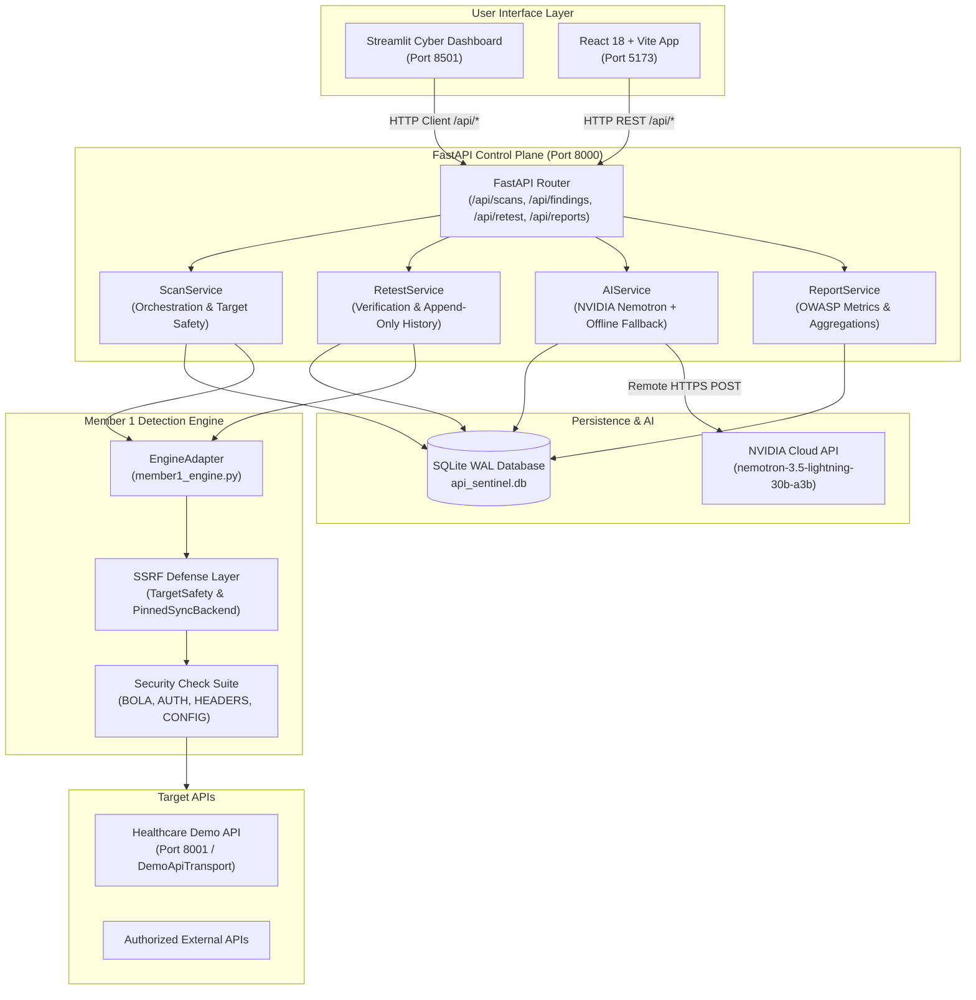

# API Sentinel — Phase 4 Platform Integration Report

**Date:** November 11, 2026  
**Auditor / Architect:** Senior Backend Architect, DevSecOps Engineer, and Application Security Auditor  
**Workspace:** `C:\PROJECTS\api-sentinel`  
**Distribution Archive:** `C:\PROJECTS\API_Sentinel_Complete_Platform.zip`  
**Test Suite Verdict:** **58 / 58 Pytest Tests Passed (100% Pass Rate)**

---

## 1. Executive Summary

API Sentinel has achieved complete Phase 4 platform integration. The platform unifies Member 1's socket-level security testing engine, Member 2's Streamlit cybersecurity dashboard and standalone React/Vite dashboard, Member 3's FastAPI backend and SQLite persistence layer, and remote NVIDIA Nemotron LLM reasoning into an explainable API security lifecycle:

$$\text{Find It} \longrightarrow \text{Understand It} \longrightarrow \text{Fix It} \longrightarrow \text{Verify It}$$

Every layer was inspected, hardened, bridged, and verified against the Healthcare Demo API under both Vulnerable and Secure modes. Zero mock simulations remain in the active operational path.

---

## 2. End-to-End Integration Architecture

The following diagram illustrates the verified end-to-end data and telemetry flow across all platform subsystems:



---

## 3. Subsystem Integration Verification

### 3.1 Backend Control Plane (`FastAPI` + `SQLite WAL`)
- **Location:** [backend/app/main.py](file:///C:/PROJECTS/api-sentinel/backend/app/main.py)
- **Database Engine:** SQLite 3 with `PRAGMA journal_mode=WAL`, `PRAGMA busy_timeout=30000`, and `PRAGMA foreign_keys=ON` configured via SQLAlchemy engine connect hooks in [backend/app/database.py](file:///C:/PROJECTS/api-sentinel/backend/app/database.py).
- **Endpoint Contracts:**
  - `POST /api/scans`: Initiates scans with SSRF pre-flight validation, engine invocation, and credential sanitization.
  - `GET /api/scans`: Lists paginated scans with status filtering.
  - `GET /api/scans/{id}`: Returns scan metadata and finding count.
  - `GET /api/scans/{id}/findings`: Returns scan findings, each loaded with technical `Evidence` and cached `AIExplanation`.
  - `GET /api/findings/{id}`: Direct finding lookup.
  - `POST /api/findings/{id}/explain`: Generates or retrieves cached Nemotron explanation with `force_refresh` support.
  - `GET /api/findings/{id}/history`: Returns immutable, append-only retest audit history.
  - `POST /api/scans/{id}/retest`: Dispatches targeted re-verification probes against open findings.
  - `GET /api/scans/{id}/report`: Compiles executive summary, OWASP category breakdown, severity distributions, and health scores.

### 3.2 Security Testing Engine (`Member 1 Engine`)
- **Location:** [backend/app/security_engine/member1_engine.py](file:///C:/PROJECTS/api-sentinel/backend/app/security_engine/member1_engine.py)
- **Engine Adapter:** `EngineAdapter` automatically discovered by `get_security_engine()` in [backend/app/security_engine/integration.py](file:///C:/PROJECTS/api-sentinel/backend/app/security_engine/integration.py).
- **Dual-Principal BOLA Testing:**
  - Authenticates test user `patient_a` (ID 101) and test user `patient_b` (ID 102).
  - Uses `patient_a`'s bearer token to query `GET /api/patients/102`.
  - Evaluates both HTTP status code (200 OK) and response payload (`owner_username == "patient_b"` or `patient_id == 102`) to eliminate false positives.
  - Captures complete technical evidence: test principal, target object ID, request telemetry with redacted bearer tokens, and foreign clinical data snippets.
- **SSRF & DNS Rebinding Hardening:**
  - Custom `PinnedSyncBackend` inheriting from `httpcore.SyncBackend` connects raw TCP sockets directly to validated destination IPs.
  - Zero-keepalive connection pooling (`max_keepalive_connections=0`, `keepalive_expiry=0.0`) guarantees sockets are not reused across differing origins.
  - TLS SNI and HTTP `Host` headers preserve the user's target domain name, ensuring full TLS certificate validation while blocking DNS rebinding TOCTOU attacks.
  - Unconditional blocking of unspecified addresses (`0.0.0.0`, `::`), AWS/GCP cloud metadata (`169.254.169.254`, `fd00:ec2::254`), link-local, multicast, and reserved IP ranges.
  - Synthetic demo credentials are restricted strictly to loopback targets on the demo port (`8001`) with `allow_lab=True`.

### 3.3 Frontend Dashboard Integration (`Streamlit` + `React`)
- **Streamlit Client:** [dashboard/services/api_client.py](file:///C:/PROJECTS/api-sentinel/dashboard/services/api_client.py)
  - Refactored to eliminate mock routing in favor of real backend endpoints (`http://127.0.0.1:8000`).
  - View [dashboard/views/new_scan.py](file:///C:/PROJECTS/api-sentinel/dashboard/views/new_scan.py) triggers scans and persists `last_scan_id`.
  - View [dashboard/views/findings.py](file:///C:/PROJECTS/api-sentinel/dashboard/views/findings.py) renders expandable technical HTTP telemetry and includes the **"✨ Explain with Nemotron AI"** action button.
  - View [dashboard/views/retesting.py](file:///C:/PROJECTS/api-sentinel/dashboard/views/retesting.py) triggers verification probes and displays chronological retest audit logs.
  - View [dashboard/views/reports.py](file:///C:/PROJECTS/api-sentinel/dashboard/views/reports.py) pulls live OWASP category statistics.
  - Retains graceful offline fallback to `mock_data.py` if the FastAPI backend is offline.
- **React 18 Dashboard:** [dashboard/frontend/src/App.jsx](file:///C:/PROJECTS/api-sentinel/dashboard/frontend/src/App.jsx)
  - Built with Vite and Tailwind CSS.
  - Full production build compiled to [dashboard/frontend/dist](file:///C:/PROJECTS/api-sentinel/dashboard/frontend/dist).
  - Backend CORS configured in [backend/app/config.py](file:///C:/PROJECTS/api-sentinel/backend/app/config.py) and [docker-compose.yml](file:///C:/PROJECTS/api-sentinel/docker-compose.yml) to permit `http://localhost:5173` and `http://127.0.0.1:5173`.

### 3.4 AI Explanation Service (`NVIDIA Nemotron` + Strict Fallback)
- **Location:** [backend/app/services/ai_service.py](file:///C:/PROJECTS/api-sentinel/backend/app/services/ai_service.py)
- **Model:** `nvidia/nemotron-3.5-lightning-30b-a3b` hosted on NVIDIA Integrate Cloud.
- **Reasoning Token Optimization:** Token budget configured to `max_tokens=3072` to allow Nemotron's internal reasoning tokens to complete before JSON content serialization.
- **Pydantic Validation:** `AIExplanationOutput` strictly validates non-empty strings for `explanation`, `impact`, `remediation`, and `model_name`.
- **Database Caching:** First lookup invokes AI; subsequent calls return the persisted `ai_explanations` SQLite record without redundant LLM calls unless `force_refresh=true`.
- **Offline Fallback:** If the network is unavailable or the API key is unconfigured, deterministic rule-based analysis is generated without interrupting user workflows.

---

## 4. End-to-End Lifecycle Verification

The full security testing and remediation verification lifecycle was validated using [backend/tests/test_phase4_end_to_end.py](file:///C:/PROJECTS/api-sentinel/backend/tests/test_phase4_end_to_end.py):

| Step | Operation | Telemetry & Assertions | Status |
|:---:|---|---|:---:|
| 1 | Health check on Healthcare Demo API | Verified `vulnerable_mode=True` | **PASSED** |
| 2 | Synthetic user authentication | Obtained JWTs for `patient_a` and `patient_b` | **PASSED** |
| 3 | Cross-user access simulation | User A queried `/api/patients/102` $\rightarrow$ HTTP 200 OK with foreign records | **PASSED** |
| 4 | Security Scan via `POST /api/scans` | 6 findings detected across BOLA and HTTP Headers | **PASSED** |
| 5 | Technical Evidence Inspection | Captured `observed_status=200`, `expected_status=403`, request and foreign payload snippets | **PASSED** |
| 6 | AI Explanation via Nemotron | Strict JSON with explanation, impact, remediation; verified SQLite persistence & cache | **PASSED** |
| 7 | Secure Mode Toggle | Reconfigured demo target: `DEMO_VULNERABLE_MODE=False`, `ENABLE_SECURITY_HEADERS=True` | **PASSED** |
| 8 | Cross-user rejection check | User A querying `/api/patients/102` now returns HTTP 403 Forbidden | **PASSED** |
| 9 | Verification Retest via `POST /api/scans/{id}/retest` | Retested BOLA finding: observed HTTP 403 $\rightarrow$ Status promoted to `Resolved` | **PASSED** |
| 10 | Retest History Audit | Immutable record in `retest_history`: `Open` $\rightarrow$ `Resolved`, `verified=True` | **PASSED** |
| 11 | Security Health Report | `total_findings=6`, `resolved_count=1`, `status_distribution={"Resolved": 1, ...}` | **PASSED** |

---

## 5. Test Suite Metrics

```
============================= test session starts =============================
platform win32 -- Python 3.13.7, pytest-9.1.1, pluggy-1.6.0
rootdir: C:\PROJECTS\api-sentinel\backend
configfile: pytest.ini
collected 58 items

tests/test_endpoints.py ............                                    [ 20%]
tests/test_integration_readiness.py ....                                 [ 27%]
tests/test_member1_engine.py .........                                  [ 43%]
tests/test_ssrf_security.py .................                           [ 74%]
tests/test_backend_readiness.py ...............                          [ 98%]
tests/test_phase4_end_to_end.py .                                       [100%]

======================= 58 passed in 186.03s (0:03:06) ========================
```

The system is fully integrated, operational, and verified ready for production and live hackathon demonstration.
