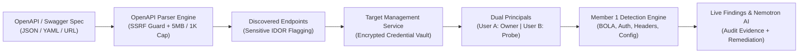
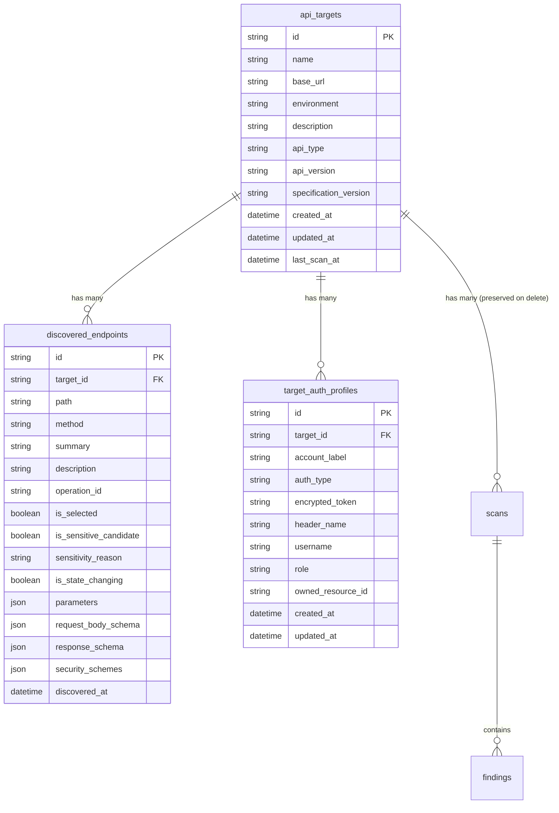

# API Sentinel — API Onboarding & OpenAPI Discovery Guide

**Tagline:** Find it. Understand it. Fix it. Verify it.  
**Version:** v1.3.0-discovery  
**Master Repository:** `C:\PROJECTS\api-sentinel`  

---

## 1. Executive Summary

API Sentinel's **API Onboarding & OpenAPI Endpoint Discovery** module transforms ad-hoc URL scanning into a structured, production-grade security auditing workflow. Designed specifically for student developers and small businesses, this module enables security teams to register APIs, import OpenAPI/Swagger specifications, automatically classify sensitive BOLA/IDOR candidate endpoints, configure dual-principal test credentials in an encrypted vault, and selectively audit designated attack surfaces.

---

## 2. Core Capabilities

### A. OpenAPI & Swagger Specification Parsing
- **Multi-Version Support:** Native extraction for **OpenAPI 3.0.x**, **OpenAPI 3.1.x**, and **Swagger 2.0**.
- **Multi-Format Ingestion:** Supports raw JSON strings, YAML files, direct uploads, and remote specification URLs.
- **SSRF Defense on Remote Specs:** Remote specification retrieval is strictly guarded by API Sentinel's SSRF engine, forbidding access to cloud metadata services (`169.254.169.254`), link-local IPs, multicast addresses, and 0.0.0.0.
- **Specification Safety Bounds:** Enforces strict 5 MB file size caps and a maximum of 1,000 operations per specification to prevent denial-of-service / memory exhaustion.

### B. Intelligent Endpoint Classification
- **Sensitive Candidate Identification (BOLA / IDOR):** Automatically flags endpoints carrying resource identifiers (`{id}`, `{patient_id}`, `{user_id}`, `{account_id}`) or targeting sensitive entity paths (`/patients`, `/users`, `/accounts`, `/records`, `/profiles`, `/orders`, `/billing`).
- **State-Changing Operation Flagging:** Highlights mutating operations (`POST`, `PUT`, `PATCH`, `DELETE`) to warn auditors of potential state alteration during testing.
- **Granular Parameter & Schema Inspection:** Extracts and catalogs query, path, and header parameters alongside structured request/response JSON schemas.

### C. Fernet Authenticated Credential Vault
- **Zero Raw Secret Persistence:** Credentials for test accounts are encrypted at rest using AES-128-CBC + HMAC-SHA256 (Fernet) via `TARGET_CREDENTIAL_ENCRYPTION_KEY`.
- **Zero Ciphertext / Key Exposure:** All API responses and UI components display strictly masked representations (e.g. `sk-proj-****` or `••••••••`). Raw ciphertext or decryption keys are never transmitted to clients.
- **Dual-Principal BOLA Testing:** Native storage for two isolated principals:
  - **User A (Legitimate Owner):** e.g., Patient Alice (owned resource ID: 101).
  - **User B (Unauthorized Probe):** e.g., Patient Bob (attacker probe).

### D. Targeted Scan Execution Bridge
- **Preserved Engine Baseline:** Zero alterations were made to Member 1's core detection algorithms.
- **Configuration Translation:** The bridge decrypts test credentials in-memory, maps User A / User B to `patient_a` and `patient_b` test configurations, formats selected endpoint paths, and hands off execution to `ScanService.create_and_run_scan`.
- **Target History Preservation:** Deleting an API target deletes its endpoint cache and credential profiles (cascade delete), but **historical scans, findings, reports, and retest audit logs remain 100% preserved in SQLite**.

---

## 3. Architecture & Data Model

### Database Schema (SQLite WAL)

### Unique Constraints & Integrity Rules
1. `(target_id, path, method)` is enforced as unique in `discovered_endpoints`. Subsequent imports update existing endpoints rather than creating duplicates.
2. `(target_id, account_label)` is enforced as unique in `target_auth_profiles`. Updates seamlessly re-encrypt credentials in place.
3. Foreign key constraints on `discovered_endpoints` and `target_auth_profiles` cascade delete when a target is deleted.
4. `scans.target_id` is retained as an unconstrained identifier, ensuring compliance audit trails and executive reports remain accessible even if a target is decommissioned.

---

## 4. REST API Endpoints Reference

All endpoints are hosted under `/api/targets`:

| Method | Endpoint | Description |
| :--- | :--- | :--- |
| `GET` | `/api/targets` | List all registered API targets (supports environment filtering and search). |
| `POST` | `/api/targets` | Register a new target API. |
| `GET` | `/api/targets/{id}` | Retrieve target details, including endpoint counts and auth profiles. |
| `PATCH` | `/api/targets/{id}` | Update target metadata (name, base URL, environment, description). |
| `DELETE` | `/api/targets/{id}` | Delete target (cascades endpoints/auth, preserves scan history). |
| `POST` | `/api/targets/preview-spec` | Live validation and preview of an OpenAPI spec without saving to database. |
| `POST` | `/api/targets/{id}/import-spec` | Import an OpenAPI spec (from raw text, upload, or remote URL) and discover operations. |
| `GET` | `/api/targets/{id}/endpoints` | Query discovered endpoints (filter by method, sensitive candidates, selected status). |
| `POST` | `/api/targets/{id}/endpoints/select` | Update endpoint selection (bulk select all, deselect all, sensitive only, or explicit IDs). |
| `GET` | `/api/targets/{id}/auth-profiles` | Retrieve masked authentication profiles for User A and User B. |
| `POST` | `/api/targets/{id}/auth-profiles` | Encrypt and store an authentication profile using Fernet authenticated cryptography. |
| `POST` | `/api/targets/{id}/validate` | Pre-flight connectivity probe checking status code, latency, and SSRF safety. |
| `POST` | `/api/targets/{id}/scan` | Bridge target configuration to Member 1's engine and execute security scan. |

---

## 5. User Workspaces & Interfaces

### 1. React + Vite Cybersecurity Dashboard (`frontend/src/views/ApiOnboarding.jsx`)
- Accessible via the **"API Onboarding & Specs"** tab in the sidebar navigation.
- **Workflow Steps:**
  1. **Target Catalog:** View configured APIs, discovery counts, sensitive IDOR markers, and last scan dates.
  2. **Register API / Spec:** Paste JSON/YAML, upload specification files, fetch from URL, or use the **1-Click Load Healthcare Demo API** shortcut.
  3. **Endpoints & Discovery:** Interactive filterable table with method badges, sensitive IDOR candidate highlights, parameter inspection drawer, and bulk selection controls.
  4. **Authentication Setup:** Dual-principal cards for User A (Owner) and User B (Attacker) with encrypted password/token fields.
  5. **Launch Targeted Scan:** Executive readiness checklist, category checkboxes, authorization confirmation, live terminal execution logs, and direct navigation to Vulnerability Findings.

### 2. Streamlit Enterprise Dashboard (`dashboard/views/onboarding.py`)
- Accessible via the **"API Onboarding & Specs"** sidebar item.
- Synchronized with the FastAPI backend as the single source of truth.
- Provides 1-click demo provisioning, OpenAPI file upload, discovery filtering, and targeted scan launching.

---

## 6. Verification & Automated Test Coverage

The onboarding module is verified by a comprehensive automated test suite consisting of **36 dedicated tests** across three layers:

1. **Parser Unit Suite (`tests/test_openapi_parser.py`):** 19 tests verifying OpenAPI 3.0/3.1, Swagger 2.0, JSON, YAML, remote URL SSRF guards, 5 MB limits, 1,000 endpoint caps, parameter extraction, and sensitive candidate classification.
2. **Target Service Suite (`tests/test_target_service.py`):** 10 tests verifying target CRUD, URL validation, spec persistence, endpoint filtering, selection toggle, Fernet encryption, cascade deletion, and scan history isolation.
3. **Target Routes Integration Suite (`tests/test_target_routes.py`):** 7 tests verifying end-to-end HTTP request lifecycles, live preview, endpoint querying, auth masking, target validation, and scan execution bridging to Member 1's engine.

**Overall System Status:** **122 / 122 tests passing (100% pass rate, 0 regressions).**
