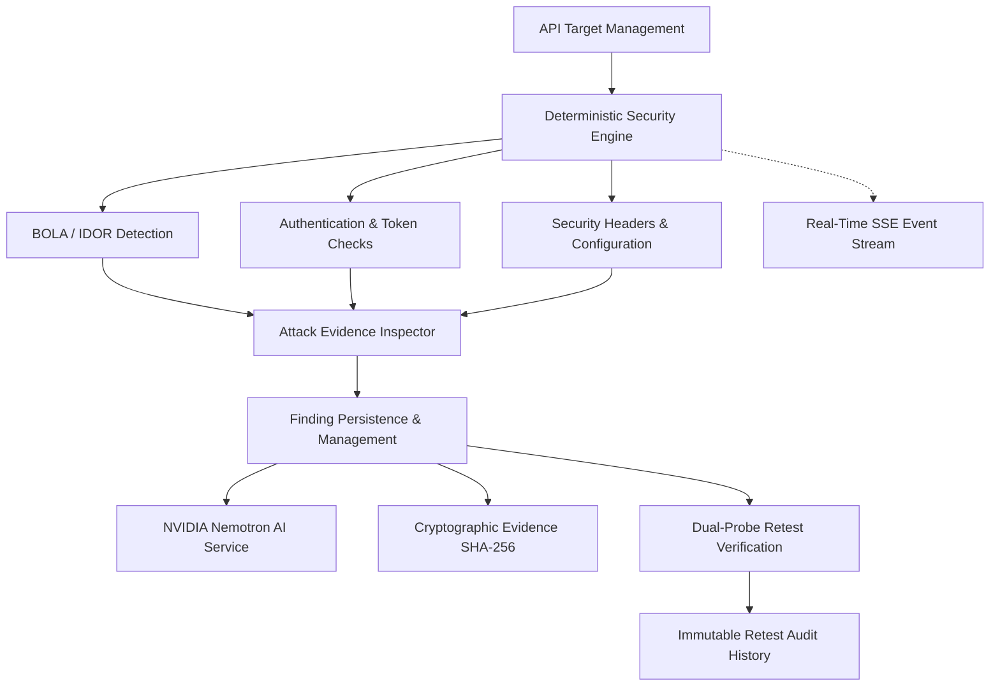
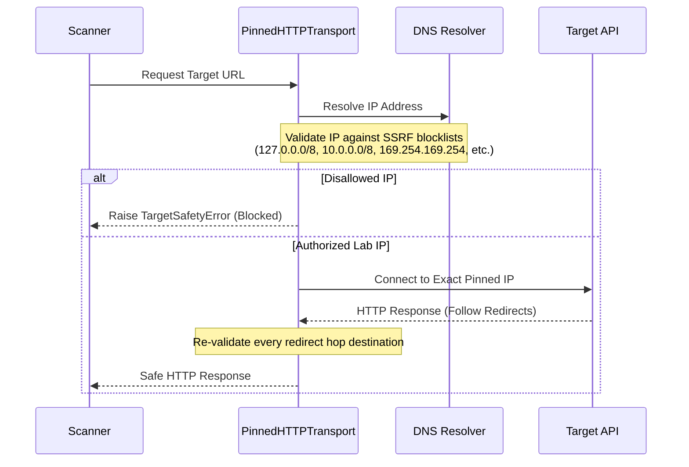

# API Sentinel — Core System Architecture Specification

**Product Identity:** API Sentinel  
**Product Tagline:** *Find it. Understand it. Fix it. Verify it.*  
**System Version:** 1.0.0 Production  
**Architecture Classification:** Deterministic API Security Testing & Explainable Remediation Platform  
**Target Audience:** Student Developers, Indie Hackers, and Small-to-Medium Businesses (SMBs)

---

## 1. Executive Summary & Design Philosophy

API Sentinel is an explainable API security testing platform designed to address the OWASP API Security Top 10 with extreme rigor, zero false-positive tolerance, and complete remediation verification. Unlike legacy dynamic application security testing (DAST) scanners that emit generic, opaque vulnerability warnings, API Sentinel is engineered around a four-stage closed-loop methodology:

1. **Find it:** Deterministic, state-aware security probes pinpoint vulnerabilities without guessing.
2. **Understand it:** Plain-English vulnerability breakdown, real attack scenarios, and tailored code fixes powered by NVIDIA Nemotron (with offline expert-rule fallback).
3. **Fix it:** Developer remediation with copyable cURL commands, exact HTTP request/response inspection, and cryptographic attack evidence.
4. **Verify it:** Automated dual-probe retesting that actively exercises owner vs. attacker privilege to verify remediation and prevent regression.

---

## 2. The 12 Core Product Capabilities

### Capability 1: API Target Management & Onboarding
- **Module:** `backend/app/routes/targets.py`, `backend/app/services/target_service.py`
- **Specification:** Supports registering API target domains with URL scheme validation, DNS resolution, and authorized lab mode toggling.
- **OpenAPI Ingestion:** `backend/app/services/openapi_parser.py` extracts endpoints, HTTP methods, route parameters, request schemas, and security schemes from OpenAPI 2.0 (Swagger), 3.0, and 3.1 specifications.
- **Credential Storage:** `backend/app/services/credential_vault.py` secures test credentials using Fernet encryption with in-memory decryption only during active probe cycles.
- **Granular Selection:** Endpoints can be individually enabled or disabled for scanning, preventing accidental execution against destructive or state-altering routes.

### Capability 2: Deterministic Vulnerability Scanning
- **Module:** `backend/app/services/scan_service.py`, `backend/app/security_engine/member1_engine.py`
- **Specification:** Orchestrates scan execution across selected categories (`BOLA`, `AUTH`, `HEADERS`).
- **Deterministic Execution:** Eliminates random fuzzing in favor of stateful, reproducible security probes.
- **Safe Execution:** Enforces timeout thresholds, payload boundaries, and transaction rollback on engine interruptions.

### Capability 3: BOLA / IDOR Detection Engine
- **Module:** `backend/app/security_engine/member1_engine.py` (`_check_bola`)
- **Specification:** Tests for Broken Object Level Authorization (OWASP API1:2023).
- **False-Positive Prevention:** Does not rely solely on HTTP 200 OK responses. Requires verification of victim-specific data tokens in the response body. If an endpoint returns 200 OK with a generic message, no vulnerability is reported.
- **Multi-Principal Validation:** Compares Owner Token (User A accessing Resource A) against Attacker Token (User B accessing Resource A).

### Capability 4: Authentication & Token Validation Checks
- **Module:** `backend/app/security_engine/member1_engine.py` (`_check_authentication`)
- **Specification:** Validates authentication enforcement across API endpoints (OWASP API2:2023).
- **Checks Performed:**
  * Missing `Authorization` header on protected endpoints.
  * Malformed / corrupted token structure.
  * Incomplete credential challenge verification.

### Capability 5: Security-Header & Configuration Checks
- **Module:** `backend/app/security_engine/member1_engine.py` (`_check_headers_and_config`)
- **Specification:** Scans response headers against security baselines (OWASP API8:2023).
- **Headers Audited:**
  * `Content-Security-Policy` (CSP)
  * `Strict-Transport-Security` (HSTS)
  * `X-Content-Type-Options` (`nosniff`)
  * `X-Frame-Options` (`DENY` / `SAMEORIGIN`)
  * Leaked technology banners (`Server`, `X-Powered-By`).

### Capability 6: Evidence Collection & Attack Inspector
- **Module:** `backend/app/security_engine/member1_engine.py`, `frontend/src/components/AttackEvidenceInspector.jsx`
- **Specification:** Captures granular forensic telemetry for every finding:
  * Complete HTTP Request: Method, URI, masked headers, body payload.
  * Complete HTTP Response: Status code, duration in milliseconds, headers, body snippet.
  * Copyable cURL command for 1-click reproduction.
  * Multi-step attack timeline diagram explaining the exploit path.

### Capability 7: Finding Management & Persistence
- **Module:** `backend/app/routes/findings.py`, `backend/app/models.py` (`Finding`)
- **Specification:** Persists detected findings in SQLite with status tracking (`Open`, `In Progress`, `Resolved`, `Still Vulnerable`, `Needs Review`).
- **Severity Scoring:** Severity levels (`Critical`, `High`, `Medium`, `Low`, `Info`) mapped to CVSS scores and OWASP categories.

### Capability 8: NVIDIA Nemotron AI Assistance & Offline Fallback
- **Module:** `backend/app/services/ai_service.py`
- **Model:** `nvidia/nemotron-4-340b-instruct` / `meta/llama-3.1-70b-instruct`
- **Strict Guardrail:** AI never determines whether a vulnerability exists. The deterministic security engine alone decides verdicts; the AI service strictly translates raw telemetry into plain-language explanations and remediation code.
- **Offline Fallback:** If the remote API key is unavailable or encounters timeouts, the engine automatically falls back to an offline expert rule system with zero downtime.

### Capability 9: Retesting Verification (Dual-Probe)
- **Module:** `backend/app/services/retest_service.py`, `backend/app/security_engine/member1_engine.py` (`_retest_bola`)
- **Specification:** Confirms remediation by re-issuing dual HTTP probes:
  * **Probe 1 (Attacker Probe):** Verifies that unauthorized access now returns HTTP 403 Forbidden or 404 Not Found.
  * **Probe 2 (Owner Probe):** Verifies that authorized owner access still returns HTTP 200 OK.
  * If both conditions pass, the finding transitions to `Resolved`.
  * If owner access is also broken, the finding transitions to `Needs Review` to prevent broken functionality.

### Capability 10: Cryptographic Evidence Integrity
- **Module:** `backend/app/routes/findings.py` (`/api/findings/{id}/export-evidence`)
- **Standard:** RFC 8785 JSON Canonicalization Scheme (JCS).
- **Digest Algorithm:** SHA-256 computed across canonical evidence parameters (finding ID, category, target URL, masked HTTP evidence, timestamp).
- **Tamper Detection:** Modifying even a single character in exported evidence invalidates the digest during verification.

### Capability 11: Retest Audit History Ledger
- **Module:** `backend/app/models.py` (`RetestHistory`), `backend/app/routes/findings.py`
- **Specification:** An append-only audit trail recording every retest attempt:
  * Timestamp of retest.
  * Prior status vs. new status.
  * Observed HTTP status codes and response bodies.
  * Remediation verification outcome (`verified: true/false`).

### Capability 12: Real-Time Scan Progress (SSE)
- **Module:** `backend/app/services/event_service.py`, `backend/app/routes/events.py`
- **Protocol:** Server-Sent Events (SSE) streaming on `/api/events/scan/{scan_id}`.
- **Events Streamed:** `SCAN_STARTED`, `ENDPOINT_PROBING`, `FINDING_DETECTED`, `SCAN_COMPLETED`, `SCAN_FAILED`.

---

## 3. Security Architecture & SSRF Prevention

### Transport Isolation (`PinnedHTTPTransport`)
- **Host Pinning:** The transport resolves DNS once and pins socket connections to the validated IP, eliminating Time-of-Check to Time-of-Use (TOCTOU) DNS rebinding attacks.
- **Metadata Protection:** Unconditionally blocks access to cloud instance metadata services (`169.254.169.254`, `fd00:ec2::254`).
- **Redirect Re-validation:** Validates every redirect target. Prevents HTTPS-to-HTTP downgrade and strips sensitive `Authorization` headers on cross-origin redirects.

---

## 4. Persistence Architecture

- **Engine:** SQLite 3 with SQLAlchemy 2.0 ORM.
- **Concurrency Mode:** Write-Ahead Logging (`PRAGMA journal_mode=WAL`).
- **Integrity Enforcements:**
  * `PRAGMA foreign_keys=ON`
  * `PRAGMA synchronous=NORMAL`
  * `PRAGMA busy_timeout=5000`
- **Transaction Safety:** Scans and retests run inside isolated sessions. Any exception triggers complete rollback, guaranteeing zero database corruption.
