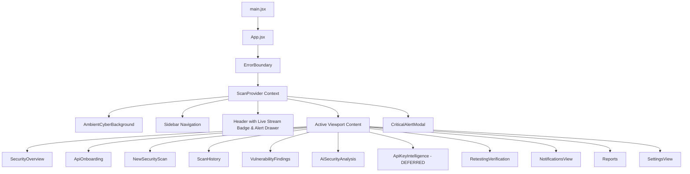
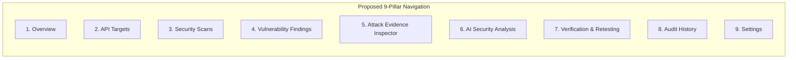
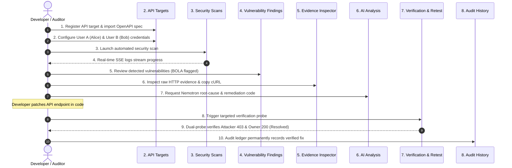

# API Sentinel — Frontend Forensic Audit & Redesign Specification

**Product Identity:** API Sentinel  
**Tagline:** *Find it. Understand it. Fix it. Verify it.*  
**Repository:** `C:\PROJECTS\api-sentinel`  
**Branch:** `feature/api-key-dataset`  
**Audit Scope:** React 18 Single-Page Application (`frontend/`)  
**Audit Date:** 2026-11-12  
**Safety Status:** Inspection and Architecture Planning Only (Zero Code Modified)

---

## 1. Existing Frontend Architecture Overview

The API Sentinel frontend is a React 18 single-page application built with Vite and packaged under `frontend/`. 

### Key Architectural Characteristics
- **State Management:** Centralized in `frontend/src/context/ScanContext.jsx`. Manages `scans`, `selectedScanId`, `activeScan`, `findings`, `notifications`, `activePopupAlert`, and active Server-Sent Events (SSE) connection (`/api/events`).
- **Routing:** Client-side hash routing (`window.location.hash` in `App.jsx`) handling 11 view identifiers (`overview`, `onboarding`, `new_scan`, `history`, `findings`, `ai_analysis`, `api_key_intel`, `retesting`, `notifications`, `reports`, `settings`).
- **HTTP Client:** Centralized in `frontend/src/services/apiClient.js` targeting `http://127.0.0.1:8000` with 30s/60s timeouts, AbortController cancellation, and standardized error parsing.
- **Visual Styling:** Cyber-security dark theme defined in `src/index.css` featuring `#050D1F` backgrounds, `#07182B` cards, `#00E5FF` electric cyan accents, and `#8B5CF6` AI purple accents.

---

## 2. Complete Frontend Component Inventory

| File Path | Component Name | Lines | Primary Responsibility | Data Source |
|---|---|---|---|---|
| `src/App.jsx` | `App` / `AppContent` | 203 | Application shell, hash router, global alert modal mount, viewport layout. | `ScanContext` |
| `src/context/ScanContext.jsx` | `ScanProvider` | 369 | State store for scans, findings, alerts, and live SSE event stream. | `/api/scans`, `/api/events` |
| `src/services/apiClient.js` | `apiClient` | 273 | Typed async wrapper for all backend REST endpoints. | FastAPI Backend |
| `src/components/Sidebar.jsx` | `Sidebar` | 243 | Vertical navigation bar with 11 view buttons, active glow, and version tag. | Static / Unread alert count |
| `src/components/Header.jsx` | `Header` | 197 | Dynamic title, subtitle, SSE live stream badge, and alert drawer trigger. | `ScanContext` |
| `src/components/KpiCards.jsx` | `KpiCards` | 198 | 4 summary metric cards: Scans, Open Findings, Verified Resolved, Health Score. | Mixed (Real counts + Artificial formula) |
| `src/components/KpiCyberGraph.jsx` | `KpiCyberGraph` | 228 | Decorative animated SVG sparkline inside KPI cards. | **Hardcoded Mock Data** |
| `src/components/ScanActivityChart.jsx` | `ScanActivityChart` | 279 | 14-day scan volume spline chart. | **Hardcoded Mock Data** |
| `src/components/SeverityDonutChart.jsx` | `SeverityDonutChart` | 151 | SVG donut chart breaking down findings by severity. | Real `findings` |
| `src/components/RecentFindingsTable.jsx` | `RecentFindingsTable` | 163 | Overview table showing latest 6 findings. | Real `findings` |
| `src/components/LastScanSummary.jsx` | `LastScanSummary` | 126 | Quick metadata panel showing current scan target, ID, and findings. | Real `activeScan` |
| `src/components/AttackEvidenceInspector.jsx` | `AttackEvidenceInspector` | 826 | Modal inspector with 5 tabs: Attack Overview, Request, Response, Timeline, Integrity. | Real `/api/findings/{id}/export-evidence` |
| `src/components/AiExplanationPanel.jsx` | `AiExplanationPanel` | 315 | Accordion displaying Nemotron root-cause, impact, and remediation code. | Real `/api/findings/{id}/explain` |
| `src/components/NotificationCenter.jsx` | `NotificationCenter` | 212 | Slide-over drawer listing recent security alerts and SSE events. | `ScanContext.notifications` |
| `src/components/CriticalAlertModal.jsx` | `CriticalAlertModal` | 191 | Blocking in-app popup modal when a Critical severity finding is detected. | `ScanContext.activePopupAlert` |
| `src/views/SecurityOverview.jsx` | `SecurityOverview` | 191 | Executive dashboard view combining KPIs, Nemotron banner, charts, and tables. | Child components |
| `src/views/ApiOnboarding.jsx` | `ApiOnboarding` | 2,519 | Multi-step target catalog, OpenAPI preview/import, endpoint selection, auth profiles. | Real `/api/targets` |
| `src/views/NewSecurityScan.jsx` | `NewSecurityScan` | 369 | Interactive scan configuration and execution view with live logging progress. | Real `/api/scans` |
| `src/views/ScanHistory.jsx` | `ScanHistory` | 228 | Historical table of past scan sessions with status filter and selection. | Real `/api/scans` |
| `src/views/VulnerabilityFindings.jsx` | `VulnerabilityFindings` | 558 | Finding catalog with search, severity filter, status badge, and inspector modal trigger. | Real `/api/scans/{id}/findings` |
| `src/views/AiSecurityAnalysis.jsx` | `AiSecurityAnalysis` | 323 | Dedicated Nemotron hub view with finding selector and explanation panel. | Real `/api/findings/{id}/explain` |
| `src/views/ApiKeyIntelligence.jsx` | `ApiKeyIntelligence` | 1,831 | Dataset testing, batch benchmark evaluation, and entropy distribution. | **Deferred / Separate Module** |
| `src/views/RetestingVerification.jsx` | `RetestingVerification` | 695 | Dual-probe verification workbench with probe logs and finding audit history. | Real `/api/scans/{id}/retest` |
| `src/views/NotificationsView.jsx` | `NotificationsView` | 281 | Full-page notification log displaying discovery events and probe results. | Duplicate of Header Drawer |
| `src/views/Reports.jsx` | `Reports` | 366 | Printable report generator and Markdown/JSON export utility. | Real `/api/scans/{id}/report` |
| `src/views/SettingsView.jsx` | `SettingsView` | 254 | Diagnostics dashboard probing `/health`, `/api/health`, and SSE health. | Real backend health probes |

---

## 3. Core Capability Mapping Matrix

Evaluation of frontend coverage across the **12 Core Backend Capabilities**:

| Core Capability | Frontend Screen / Component | Real Endpoint Connected? | Data Fidelity | Redesign / Integration Status |
|---|---|---|---|---|
| **1. Target Management** | `ApiOnboarding.jsx` | `GET/POST /api/targets`, `POST /api/targets/{id}/validate` | **100% Real** | Working. Needs consolidation into unified `API Targets` view. |
| **2. OpenAPI Parsing** | `ApiOnboarding.jsx` | `POST /api/targets/preview-spec`, `POST .../import-spec` | **100% Real** | Working. Parses Swagger 2.0, OpenAPI 3.0, 3.1. |
| **3. Deterministic Scanner** | `NewSecurityScan.jsx` | `POST /api/scans` | **100% Real** | Working. Executes real scan with categories `[BOLA, AUTH, HEADERS]`. |
| **4. BOLA / IDOR Detection** | `VulnerabilityFindings.jsx`, `AttackEvidenceInspector.jsx` | `/api/scans/{id}/findings` | **100% Real** | Working. Displays dual-principal exploit evidence and leaked payload. |
| **5. Authentication Validation** | `VulnerabilityFindings.jsx` | `/api/scans/{id}/findings` | **100% Real** | Working. Shows missing/malformed auth probe telemetry. |
| **6. Security Headers Auditing** | `VulnerabilityFindings.jsx` | `/api/scans/{id}/findings` | **100% Real** | Working. Displays missing CSP, HSTS, X-Content-Type-Options. |
| **7. Attack Evidence Inspector** | `AttackEvidenceInspector.jsx` | `GET /api/findings/{id}/export-evidence` | **100% Real** | Working as a modal. **Needs promotion to dedicated workspace view.** |
| **8. Nemotron AI Intelligence** | `AiExplanationPanel.jsx`, `AiSecurityAnalysis.jsx` | `POST /api/findings/{id}/explain` | **100% Real** | Working. Real LLM explanation with deterministic rule fallback. |
| **9. Dual-Probe Retesting** | `RetestingVerification.jsx` | `POST /api/scans/{id}/retest` | **100% Real** | Working. Real dual-probe verification (Owner 200 OK + Attacker 403 Forbidden). |
| **10. SHA-256 Evidence Integrity** | `AttackEvidenceInspector.jsx` (Tab 5) | `GET /api/findings/{id}/export-evidence` | **100% Real** | Working. Computes and displays cryptographic SHA-256 digest. |
| **11. Retest Audit History** | `RetestingVerification.jsx` | `GET /api/findings/{id}/history` | **100% Real** | Working inside finding selector. **Needs dedicated top-level Audit History view.** |
| **12. Real-Time SSE Telemetry** | `ScanContext.jsx`, `Header.jsx`, `NotificationsView.jsx` | `GET /api/events` | **100% Real** | Working. Live stream active with auto-reconnection and alerts. |

---

## 4. Identification of Unnecessary, Mock & Disconnected UI Elements

### 4.1 Mock & Artificial Elements to Eliminate
1. **`ScanActivityChart.jsx` (Hardcoded Mock Data):**
   - *Problem:* Hardcodes 14 arbitrary dates (`Oct 27` to `Nov 09`) and static scan numbers (`[1.0, 1.8, 2.8, 2.0, 5.0...]`). It does not query historical scan data from SQLite.
   - *Recommendation:* Replace with a real daily aggregation derived from `scans[].created_at`, or display a clean, factual historical timeline.
2. **`KpiCards.jsx` Health Score (Artificial Formula):**
   - *Problem:* Uses a synthetic heuristic: `100 - (crit*25 + high*15 + med*8 + low*3) + (fixedVulns*10)`. The prompt explicitly requires avoiding "Artificial health scores".
   - *Recommendation:* Replace with factual compliance metrics: **Total Scanned Endpoints**, **Vulnerability Resolution Rate (%)**, or **Active Targets**.
3. **`KpiCyberGraph.jsx` (Decorative Dummy Sparklines):**
   - *Problem:* Contains static hardcoded trajectory arrays (`trendData = { scans: [13.2, 15.8...], vulns: [45.5...], fixed: [16.0...] }`).
   - *Recommendation:* Remove decorative mock curves; let clean typography and real metrics tell the security story.

### 4.2 Duplicate & Disconnected Navigation Sections
1. **Duplicate Notifications:** `NotificationsView.jsx` duplicates the slide-out `NotificationCenter.jsx` triggered from the Header bell icon. Having both a full-page view and a header drawer creates confusion.
   - *Recommendation:* Keep the Header drawer for real-time alerts. Retire `NotificationsView` as a standalone sidebar tab.
2. **Fragmented Scan Experience:** `NewSecurityScan.jsx` and `ScanHistory.jsx` are currently split into separate sidebar items.
   - *Recommendation:* Unify them into a single coherent **Security Scans** workspace with tabs: `[Active Scan Launch]`, `[Live Session Progress]`, and `[Historical Audit Registry]`.
3. **Decoupled API Key Intelligence:** `ApiKeyIntelligence.jsx` (1,831 lines) consumes prominent sidebar placement (#7) despite being an offline dataset benchmark tool rather than a core API vulnerability scanning capability.
   - *Recommendation:* Defer from primary navigation. Relocate under an "Experimental / Tools" expandable menu or separate route.
4. **Modal-Only Evidence Inspector:** `AttackEvidenceInspector.jsx` is currently trapped as an inner modal inside `VulnerabilityFindings.jsx`. A user cannot bookmark or directly navigate to an evidence investigation session.
   - *Recommendation:* Elevate `Attack Evidence Inspector` into a primary first-class navigation view.

---

## 5. Proposed Final Dashboard Navigation Structure (The 9 Core Views)

### 1. Overview
- **Purpose:** High-level cybersecurity posture overview for developers and auditors.
- **Key Components:**
  * 4 Real KPI Cards: **Total Scans Run**, **Open Vulnerabilities**, **Verified Resolved**, **Remediation Rate (%)**.
  * Severity Breakdown Donut Chart (derived from real `findings`).
  * Active / Most Recent Scan Session Card (target URL, scan ID, completion time).
  * Recent Findings Table (top 6 unverified findings with 1-click Inspect).
- **Backend Endpoints:** `GET /api/scans`, `GET /api/scans/{id}/findings`.

### 2. API Targets
- **Purpose:** Comprehensive target onboarding and discovery management.
- **Key Components:**
  * Target Catalog Table (registered targets, environment, status, endpoints count).
  * Target Registration & Validation Form (`POST /api/targets`, `POST /api/targets/{id}/validate`).
  * OpenAPI 2.0/3.0/3.1 Spec Discovery & Live Preview (`preview-spec`, `import-spec`).
  * Granular Endpoint Selector (sensitive endpoint tagging, toggleable scope).
  * Dual-Principal Auth Profile Configuration (User A Owner vs. User B Attacker).
- **Backend Endpoints:** `GET/POST/PATCH/DELETE /api/targets`, `GET /api/targets/{id}/endpoints`, `POST .../endpoints/select`, `GET/POST /api/targets/{id}/auth-profiles`.

### 3. Security Scans
- **Purpose:** Unified scan execution, real-time SSE progress, and historical registry.
- **Key Components:**
  * **Tab A: Launch Scan:** Select registered target, choose profile (OWASP API Top 10), confirm authorization.
  * **Tab B: Live Scan Session:** Real-time terminal log, progress bar, animated step indicators powered by SSE events (`scan_created`, `scan_completed`).
  * **Tab C: Historical Scan Registry:** Paginated list of all past scans with status filtering, date range, and quick findings count.
- **Backend Endpoints:** `POST /api/scans`, `GET /api/scans`, `GET /api/events`.

### 4. Vulnerability Findings
- **Purpose:** Central finding explorer and triaging console.
- **Key Components:**
  * Search by vulnerability name, endpoint, or OWASP category.
  * Filters for Severity (`Critical`, `High`, `Medium`, `Low`) and Status (`Open`, `Resolved`, `Still Vulnerable`, `Needs Review`).
  * Detailed finding cards with expandable technical evidence.
  * Quick-Action buttons on every finding:
    * 🔍 *Inspect Attack Evidence* $\to$ opens in Evidence Inspector.
    * ✨ *Nemotron AI Explain* $\to$ opens in AI Analysis.
    * 🔄 *Verify Remediation* $\to$ triggers retest probe.
- **Backend Endpoints:** `GET /api/scans/{id}/findings`, `GET /api/findings/{id}`.

### 5. Attack Evidence Inspector
- **Purpose:** Deep-dive forensic attack reconstruction workspace.
- **Key Components:**
  * Finding selector dropdown (or pre-selected via navigation state).
  * Visual Multi-Principal Exploit Flow (Alice vs. Bob token comparison).
  * Raw HTTP Request tab (masked headers, copyable sanitized cURL command).
  * Raw HTTP Response tab (status code, latency ms, leaked foreign data fields).
  * Attack Timeline tab (step-by-step scanner probe decisions).
  * RFC 8785 Canonical JSON Evidence Export with verified SHA-256 digest seal.
- **Backend Endpoints:** `GET /api/findings/{id}/export-evidence`.

### 6. AI Security Analysis
- **Purpose:** Explainable vulnerability intelligence powered by NVIDIA Nemotron.
- **Key Components:**
  * Finding selector dropdown.
  * Active Engine Indicator: Live Nemotron 340B vs. Offline Expert Rule Fallback.
  * Plain-English Root Cause Analysis (why the vulnerability exists).
  * Business & Threat Scenario Breakdown (potential compliance/data leak impact).
  * Copy-paste Remediation Code (framework-specific patches in FastAPI/Python/Node).
  * Legal & Engineering Verification Disclaimer.
- **Backend Endpoints:** `POST /api/findings/{id}/explain`.

### 7. Verification & Retesting
- **Purpose:** Automated dual-probe regression verification workbench.
- **Key Components:**
  * Finding or Scan Scope Selector.
  * "Execute Dual-Probe Verification" action button.
  * Live Probing Telemetry Console:
    * Probe 1 (Attacker Probe): Confirms HTTP 403 Forbidden on victim resource.
    * Probe 2 (Owner Probe): Confirms legitimate HTTP 200 OK access remains functional.
  * Instant Verdict Card: `Resolved` vs. `Still Vulnerable` vs. `Needs Review`.
- **Backend Endpoints:** `POST /api/scans/{id}/retest`.

### 8. Audit History
- **Purpose:** Immutable append-only audit ledger of all verification probes.
- **Key Components:**
  * Chronological ledger of every retest attempt across all scans.
  * Target endpoint, timestamp, prior status $\to$ new status.
  * Observed HTTP status codes, latency, and verification outcome (`verified: true/false`).
  * Filter by finding or date range.
- **Backend Endpoints:** `GET /api/findings/{id}/history`.

### 9. Settings
- **Purpose:** Infrastructure health, persistence status, and diagnostics.
- **Key Components:**
  * Backend API Health Probe (`/api/health`).
  * SQLite Persistence Status (WAL mode verification, disk storage).
  * Real-time Server-Sent Events (SSE) telemetry stream probe (`/api/events`).
  * Active environment configuration (Lab Mode enabled/disabled, AI model name).
- **Backend Endpoints:** `GET /health`, `GET /api/health`, `GET /api/events/status`.

---

## 6. End-to-End User Workflow Alignment

The proposed 9 views support the complete, uninterrupted user workflow:

---

## 7. Backend API Contract Mapping

| Frontend Need | Method | Backend URL | Status | Notes |
|---|---|---|---|---|
| Health Check | `GET` | `/health` & `/api/health` | Fully Connected | Returns status, environment, database status. |
| Target List | `GET` | `/api/targets` | Fully Connected | Supports `environment`, `search`, `skip`, `limit`. |
| Target Create | `POST` | `/api/targets` | Fully Connected | Validates URL format and lab mode boundaries. |
| Spec Preview | `POST` | `/api/targets/preview-spec` | Fully Connected | Previews endpoints without saving to DB. |
| Spec Import | `POST` | `/api/targets/{id}/import-spec`| Fully Connected | Parses Swagger/OpenAPI into `TargetEndpoint` rows. |
| Endpoint List | `GET` | `/api/targets/{id}/endpoints` | Fully Connected | Supports filtering by method and sensitivity. |
| Endpoint Scope | `POST` | `/api/targets/{id}/endpoints/select`| Fully Connected | Bulk or granular selection toggle. |
| Auth Profiles | `GET/POST`| `/api/targets/{id}/auth-profiles`| Fully Connected | Encrypted storage of Alice/Bob tokens. |
| Scan Create | `POST` | `/api/scans` | Fully Connected | Triggers Member 1 deterministic engine. |
| Scan List | `GET` | `/api/scans` | Fully Connected | Returns paginated list of scans. |
| Scan Details | `GET` | `/api/scans/{id}` | Fully Connected | Returns status, total findings, configuration. |
| Scan Findings | `GET` | `/api/scans/{id}/findings` | Fully Connected | Returns findings list with evidence. |
| AI Explanation | `POST` | `/api/findings/{id}/explain`| Fully Connected | Supports `?force_refresh=true`. |
| Evidence Export| `GET` | `/api/findings/{id}/export-evidence`| Fully Connected | RFC 8785 canonical JSON + SHA-256 digest. |
| Retest Finding | `POST` | `/api/scans/{id}/retest` | Fully Connected | Dual-probe verification probe. |
| Retest History | `GET` | `/api/findings/{id}/history`| Fully Connected | Chronological append-only audit list. |
| SSE Stream | `GET` | `/api/events` | Fully Connected | Server-Sent Events real-time event bus. |

---

## 8. Summary of Files for Future Implementation

When implementation is authorized, modifications will be contained to:

1. `frontend/src/App.jsx`: Update routing to 9 core views; promote Evidence Inspector and Audit History.
2. `frontend/src/components/Sidebar.jsx`: Update navigation list to the 9 primary views; remove deferred items.
3. `frontend/src/components/KpiCards.jsx`: Replace synthetic health score formula with factual resolution rate (%).
4. `frontend/src/components/ScanActivityChart.jsx`: Replace hardcoded dates/numbers with real SQLite scan activity.
5. `frontend/src/views/SecurityScans.jsx` (New unified view): Merge `NewSecurityScan.jsx` and `ScanHistory.jsx`.
6. `frontend/src/views/AuditHistoryView.jsx` (New dedicated view): Surface full historical retest ledger.
7. `frontend/src/views/AttackEvidenceInspectorView.jsx`: Standalone full-screen workspace wrapper around `AttackEvidenceInspector.jsx`.
