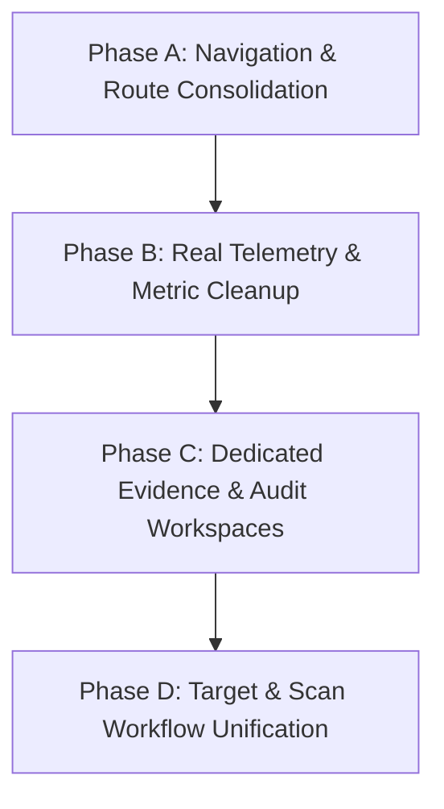

# API Sentinel — Frontend Implementation Roadmap

**Document:** Implementation & Transition Strategy  
**Target Architecture:** 9-Pillar Cohesive Cybersecurity SaaS Dashboard  
**Status:** Planning & Blueprint (Awaiting User Authorization)

---

## 1. Overview & Strategy

The redesign will transition the API Sentinel frontend from a fragmented, partially-mocked dashboard into a cohesive, production-grade cybersecurity platform that faithfully maps to the 12 core backend capabilities.

To eliminate risk and preserve functionality, the implementation is divided into **4 small, self-contained phases**:

---

## 2. Phase-by-Phase Implementation Plan

### Phase A: Navigation & Route Consolidation
- **Objective:** Establish the clean 9-item primary navigation structure without breaking existing components.
- **Tasks:**
  1. Update `Sidebar.jsx` nav items to the approved 9 sections:
     * `overview` (Overview)
     * `targets` (API Targets)
     * `scans` (Security Scans)
     * `findings` (Vulnerability Findings)
     * `evidence` (Attack Evidence Inspector)
     * `ai_analysis` (AI Security Analysis)
     * `retesting` (Verification & Retesting)
     * `audit_history` (Audit History)
     * `settings` (Settings)
  2. In `App.jsx`, update the router hash mapping to route these 9 views.
  3. Relocate `ApiKeyIntelligence` into an optional secondary route or deferred tools view.
  4. Ensure existing deep links and URL hashes gracefully redirect to their new counterparts.
- **Verification Gate:** Verify sidebar switching works across all 9 views with zero console errors.

---

### Phase B: Real Telemetry & Metric Cleanup
- **Objective:** Eliminate artificial formulas and hardcoded mock charts from the Overview dashboard.
- **Tasks:**
  1. **`KpiCards.jsx`:**
     * Remove the synthetic mathematical formula for "Health Score".
     * Replace with **Remediation Resolution Rate (%)** (`fixedVulns / (openVulns + fixedVulns) * 100`).
     * Remove `KpiCyberGraph` hardcoded dummy curve trajectories.
  2. **`ScanActivityChart.jsx`:**
     * Remove hardcoded dates (`Oct 27` to `Nov 09`) and static values (`[1.0, 1.8...]`).
     * Aggregate real scan creation counts from `scans[]` over the last 7 to 14 days.
     * If scan count is low (e.g. fresh installation), display a clean empty state with a "Run First Scan" call to action.
- **Verification Gate:** Verify Overview renders 100% genuine data backed by the SQLite database.

---

### Phase C: Dedicated Evidence & Audit Workspaces
- **Objective:** Elevate Attack Evidence Inspector and Audit History into first-class views.
- **Tasks:**
  1. Create a dedicated full-view wrapper `AttackEvidenceInspectorView.jsx`:
     * Allows selecting any detected finding via dropdown.
     * Directly embeds `AttackEvidenceInspector` without requiring modal popups.
     * Retains the modal mode for quick in-line inspection from `VulnerabilityFindings.jsx`.
  2. Create `AuditHistoryView.jsx`:
     * Dedicated view querying `/api/findings/{id}/history` or aggregated retest events.
     * Chronological audit ledger displaying timestamp, endpoint, old status, new status, and verified badge.
- **Verification Gate:** Confirm users can navigate directly to `#evidence` and `#audit_history` and inspect cryptographic SHA-256 hashes and probe history.

---

### Phase D: Target & Scan Workflow Unification
- **Objective:** Streamline the developer journey from Target Onboarding $\to$ Scan Execution $\to$ Remediation.
- **Tasks:**
  1. Rename and consolidate `ApiOnboarding.jsx` into `ApiTargetsView.jsx`:
     * Preserve all working target CRUD, OpenAPI preview/import, endpoint selection, and auth profile configuration.
     * Add a direct "Launch Scan" quick-action button on configured targets that pre-populates the scan form.
  2. Merge `NewSecurityScan.jsx` and `ScanHistory.jsx` into `SecurityScansView.jsx`:
     * Tab 1: **New Scan** (select target, scan profile, categories, start probe).
     * Tab 2: **Active Session** (live terminal output, SSE event stream progress bar).
     * Tab 3: **Scan History** (paginated table of completed scans).
- **Verification Gate:** Run live multi-service scan through the unified UI and verify real-time SSE progress updates.

---

## 3. Rollback & Preservation Safeguards

- Every phase maintains 100% backward compatibility with the existing FastAPI backend REST schemas.
- No backend code changes are required.
- Original views and components remain in the repository and are imported into unified views, guaranteeing zero data loss or broken imports.
- Verification tests will be executed after each phase.
