# API SENTINEL — FRONTEND IMPROVEMENT & REMEDIATION ROADMAP
**Document Reference:** `docs/frontend/FRONTEND_IMPROVEMENT_ROADMAP.md`  
**Classification:** Enterprise Engineering Execution Roadmap  
**Target Platform:** `C:\PROJECTS\api-sentinel\frontend`  
**Branch:** `feature/api-key-dataset`  
**Runtime:** React 18.3.1 + Vite 5.2.11 + FastAPI 1.0.0 + NVIDIA Nemotron 3.5  
**Author:** Principal Frontend Architect & Application Security Auditor  
**Date:** November 12, 2026  
**Status:** PROPOSED & READY FOR APPROVAL (AUDIT ONLY — Zero code executed)

---

## 1. EXECUTIVE SUMMARY & ROADMAP ARCHITECTURE

Following the forensic analysis documented in `docs/frontend/FRONTEND_MASTER_FORENSIC_AUDIT.md`, this roadmap outlines a structured, phased, zero-downtime remediation strategy for all **32 identified defects**.

The roadmap is decomposed into **6 independent, test-gated implementation phases** plus an automated regression gate. Each phase is self-contained: it can be executed, verified with tests, and reviewed without destabilizing downstream components or modifying backend API contracts.

```mermaid
flowchart TD
    subgraph PHASE_1["Phase 1: Security & Destructive Action Hardening"]
        P1A["Replace window.confirm with CyberDialog (DEF-001)"]
        P1B["Backend Proxy for Remote Specs (DEF-003)"]
        P1C["Forensic Hash Fallback Disclaimers (DEF-005)"]
        P1D["Mask Dual-Principal Auth Tokens (DEF-006)"]
        P1E["Trap Modal Focus & Prevent Scroll (DEF-020)"]
    end

    subgraph PHASE_2["Phase 2: Global State & Context Synchronization"]
        P2A["Wire refreshTargets() in ApiOnboarding (DEF-002)"]
        P2B["SSE Reconnection Backfill Buffer (DEF-010)"]
        P2C["Workspace Scroll-to-Top Navigation (DEF-022)"]
        P2D["Retest Deduplication Notice (DEF-023)"]
    end

    subgraph PHASE_3["Phase 3: Data Integrity & Telemetry Scoping"]
        P3A["Zero-Finding 100% Clean Baseline HUD (DEF-004)"]
        P3B["Harmonize Overview Platform vs Scan Scope (DEF-007)"]
        P3C["Dynamic Baseline Comparison Badges (DEF-027)"]
        P3D["Humanized Scan Duration (DEF-032)"]
    end

    subgraph PHASE_4["Phase 4: Component Resilience & Race-Condition Defense"]
        P4A["Debounce Retest Button (DEF-008)"]
        P4B["Factual Scan Progress Interpolation (DEF-009)"]
        P4C["Abort Concurrent Nemotron Queries (DEF-011)"]
        P4D["Debounce Audit History Search (DEF-014)"]
        P4E["Web Worker Spec Parsing (DEF-021)"]
    end

    subgraph PHASE_5["Phase 5: Enterprise UI/UX & Accessibility Polish"]
        P5A["Sidebar Icon Tooltips on Collapse (DEF-015)"]
        P5B["Empty State 1-Click Launch CTAs (DEF-016)"]
        P5C["Keyboard Accessible Tables & Charts (DEF-017, DEF-024)"]
        P5D["ARIA Live Announcements (DEF-018)"]
        P5E["Notification Drawer Fluid Animations (DEF-019)"]
        P5F["OWASP Batch Selection Toggles (DEF-025)"]
        P5G["Clipboard Paste for Key Datasets (DEF-026)"]
    end

    subgraph PHASE_6["Phase 6: Code Quality, Performance & Diagnostics"]
        P6A["PDF Print Stylesheets for Reports (DEF-012)"]
        P6B["Humanized Offline Backend Diagnostics (DEF-013)"]
        P6C["SSE Live Latency Tooltip (DEF-028)"]
        P6D["CSS Cleanup & Selector De-duplication (DEF-029)"]
        P6E["Canvas RAF Visibility Throttling (DEF-030, DEF-031)"]
    end

    subgraph PHASE_7["Phase 7: End-to-End Regression Verification"]
        P7A["Extend Node.js TAP Test Suite (32 Defect Assertions)"]
        P7B["Production Build & Vite Bundle Analysis"]
        P7C["Dual-Process Health Certification"]
    end

    PHASE_1 --> PHASE_2
    PHASE_2 --> PHASE_3
    PHASE_3 --> PHASE_4
    PHASE_4 --> PHASE_5
    PHASE_5 --> PHASE_6
    PHASE_6 --> PHASE_7
```

---

## 2. PHASE-BY-PHASE IMPLEMENTATION PLAN

### PHASE 1: Security & Destructive Action Hardening
**Priority:** CRITICAL  
**Estimated Complexity:** Low-to-Medium (4–6 hours)  
**Risk Level:** Low (Self-contained security controls)  
**Defects Addressed:** `DEF-001`, `DEF-003`, `DEF-005`, `DEF-006`, `DEF-020`

#### 1.1 Technical Objectives
1. Eliminate all unstyled, blocking browser-native dialogs (`window.confirm`) by creating a unified `CyberConfirmationDialog.jsx` modal adhering to the cybersecurity HUD design system.
2. Route remote OpenAPI specification downloads through the existing FastAPI proxy endpoint (`/api/targets/proxy-spec`) rather than issuing direct browser-side `fetch` calls, terminating CORS errors and protecting client IP.
3. Enforce cryptographic integrity status visualization on all telemetry cards in `AttackEvidenceInspector.jsx`. When RFC 8785 canonical hash cannot be computed due to missing raw bodies, render a distinct warning badge: `⚠️ UNSEALED TELEMETRY — MISSING CRYPTOGRAPHIC DIGEST`.
4. Obfuscate sensitive credentials in the Dual-Principal authorization configuration form (`ApiOnboarding.jsx`) using toggleable masked input fields (`••••••••`) with clipboard copy controls.
5. Implement focus trapping and `document.body.style.overflow = 'hidden'` on `CriticalAlertModal.jsx` to prevent background keyboard and mouse scroll bleed during security alerts.

#### 1.2 Target Files
- `src/components/CyberConfirmationDialog.jsx` (New reusable modal component)
- `src/views/ApiOnboarding.jsx`
- `src/services/apiClient.js`
- `src/components/AttackEvidenceInspector.jsx`
- `src/components/CriticalAlertModal.jsx`

#### 1.3 Verification Criteria
- Native `window.confirm` is never invoked in any code path.
- Deleting an API target renders a glassmorphic dialog with target name, impacted endpoint count, and required "CONFIRM DELETION" action.
- Remote Swagger/OpenAPI URLs load without CORS violations.
- Dual-principal bearer tokens remain masked by default.

---

### PHASE 2: Global State & Context Synchronization
**Priority:** CRITICAL / HIGH  
**Estimated Complexity:** Medium (5–7 hours)  
**Risk Level:** Medium (Touches global `ScanContext`)  
**Defects Addressed:** `DEF-002`, `DEF-010`, `DEF-022`, `DEF-023`

#### 2.1 Technical Objectives
1. Connect `ApiOnboarding.jsx` directly to `useScanContext().refreshTargets()`. When a new target is registered, validated, or deleted in the inventory, trigger the centralized context refresh so `NewSecurityScan.jsx` and `AttackEvidenceWorkspace.jsx` immediately reflect the updated target inventory without requiring a browser page refresh.
2. Upgrade `ScanContext.jsx` SSE event listener with an offline message buffer and reconnect backfill handshake. If an SSE connection drops and reconnects, query `/api/scans/active` and `/api/scans/recent` to catch up on any missed scan completion or finding discovery events.
3. Introduce route-change scroll reset in `App.jsx` so that switching between workspaces via the sidebar or hash routing automatically scrolls the viewport to `(0, 0)`.
4. In `RetestingVerification.jsx`, check the current finding status before triggering a probe. If the finding is already marked `VERIFIED_FIXED`, display an informational warning badge explaining that retesting will register an additional verification audit entry.

#### 2.2 Target Files
- `src/context/ScanContext.jsx`
- `src/views/ApiOnboarding.jsx`
- `src/views/RetestingVerification.jsx`
- `src/App.jsx`

#### 2.3 Verification Criteria
- Registering a target in *API Targets & Inventory* immediately populates the target dropdown in *Launch Targeted Scan* without refreshing.
- Terminating the backend for 5 seconds during a scan and restarting it does not leave the frontend scan status in a zombie "RUNNING" state.
- Navigating to any workspace scrolls to top.

---

### PHASE 3: Data Integrity & Factual Telemetry Scope
**Priority:** CRITICAL / HIGH  
**Estimated Complexity:** Low-to-Medium (4–5 hours)  
**Risk Level:** Low (Display and aggregation logic)  
**Defects Addressed:** `DEF-004`, `DEF-007`, `DEF-027`, `DEF-032`

#### 3.1 Technical Objectives
1. Resolve the zero-finding division anomaly in `KpiCards.jsx`. When an API has 0 findings (`totalFindings === 0`), render `100%` with the subtitle `100% Clean Baseline (Zero Vulnerabilities Detected)` instead of `0% Fixed`.
2. Harmonize Overview HUD scoping:
   - Provide an explicit scope selector toggle on `SecurityOverview.jsx`: `[ All Scans (Platform) | Selected Scan: Healthcare Demo ]`.
   - Update Card 1 (`TOTAL SCANS`), Card 2 (`OPEN FINDINGS`), Card 3 (`VERIFIED RESOLVED`), and Card 4 (`RESOLUTION RATE`) to strictly respect the selected scope toggle, clearly indicating whether metrics represent enterprise-wide risk or single-audit results.
3. Suppress or humanize the trend badges (`vs. previous period`) when only a single baseline audit exists, displaying `Initial Baseline Audit` instead of artificial percentage comparisons.
4. Replace raw second counters (e.g. `124s`) in `ScanHistory.jsx` with formatted duration strings (`2m 04s`).

#### 3.2 Target Files
- `src/components/KpiCards.jsx`
- `src/views/SecurityOverview.jsx`
- `src/views/ScanHistory.jsx`

#### 3.3 Verification Criteria
- Clean scans show `100%` resolution rate with emerald success glow.
- Scope toggle accurately updates all 4 KPI cards and donut chart simultaneously.
- Trend subtitles show factual baseline indicators.

---

### PHASE 4: Component Resilience & Race-Condition Defense
**Priority:** HIGH  
**Estimated Complexity:** Medium-to-High (6–8 hours)  
**Risk Level:** Medium (Concurrency controls)  
**Defects Addressed:** `DEF-008`, `DEF-009`, `DEF-011`, `DEF-014`, `DEF-021`

#### 4.1 Technical Objectives
1. Implement a 2000ms debounce guard and loading lock on the "Execute Dual-Probe Verification" button in `RetestingVerification.jsx` to prevent concurrent duplicate probe executions on slow networks.
2. Replace artificial timer-based scan progress estimation in `NewSecurityScan.jsx` with telemetry-driven interpolation based on actual endpoint audit completion counts emitted over SSE (`endpointsCompleted / totalEndpoints`).
3. Add `AbortController` cancellation to `AiExplanationPanel.jsx` and `VulnerabilityFindings.jsx`. When a user rapidly clicks between different finding cards, immediately abort in-flight NVIDIA Nemotron requests to prevent out-of-order UI overwrites and wasted token consumption.
4. Implement a 300ms debounce hook (`useDebounce`) on the search filter input in `AuditHistoryWorkspace.jsx` to eliminate main-thread stuttering on large audit logs.
5. Offload parsing of large OpenAPI/Swagger YAML specifications (>2MB) in `ApiOnboarding.jsx` to a dedicated Web Worker (`specParser.worker.js`) to maintain 60 FPS UI responsiveness.

#### 4.2 Target Files
- `src/views/RetestingVerification.jsx`
- `src/views/NewSecurityScan.jsx`
- `src/views/VulnerabilityFindings.jsx`
- `src/components/AiExplanationPanel.jsx`
- `src/views/AuditHistoryWorkspace.jsx`
- `src/views/ApiOnboarding.jsx`
- `src/workers/specParser.worker.js` (New web worker)

#### 4.3 Verification Criteria
- Spamming the Retest button results in exactly 1 HTTP request.
- Fast scans do not jump abruptly from 65% to 100%.
- Rapid clicking across 5 finding cards issues 1 final AI request; previous 4 are aborted.
- Typing rapidly in audit search maintains steady 60 FPS.

---

### PHASE 5: Enterprise UI/UX & Accessibility Polish
**Priority:** MEDIUM  
**Estimated Complexity:** Medium (5–7 hours)  
**Risk Level:** Low (Visual & Interaction Enhancements)  
**Defects Addressed:** `DEF-015`, `DEF-016`, `DEF-017`, `DEF-018`, `DEF-019`, `DEF-024`, `DEF-025`, `DEF-026`

#### 5.1 Technical Objectives
1. Add floating glassmorphic tooltip pills to `Sidebar.jsx` navigation icons when the sidebar collapses to compact icon mode on screens <1280px.
2. Add intuitive 1-click CTA buttons (`[ Launch First Security Scan ]`) inside empty states on `ScanActivityChart.jsx` and `RecentFindingsTable.jsx`.
3. Add keyboard accessibility attributes (`role="button"`, `tabIndex={0}`, `onKeyDown` handlers for Enter/Space) to all interactive rows in `RecentFindingsTable.jsx` and SVG donut slices in `SeverityDonutChart.jsx`.
4. Wrap code snippet copy actions in `AiExplanationPanel.jsx` with an accessible ARIA live region (`role="status" aria-live="polite"`) announcing "Remediation code copied to clipboard".
5. Enhance notification drawer dismissals in `NotificationCenter.jsx` with smooth slide-and-fade CSS exit transitions.
6. Provide "Select All" and "Deselect All" convenience toggles for the 10 OWASP vulnerability test categories in `NewSecurityScan.jsx`.
7. Add a "Paste from Clipboard" button with validation to the batch token analysis input in `ApiKeyIntelligence.jsx`.

#### 5.2 Target Files
- `src/components/Sidebar.jsx`
- `src/components/ScanActivityChart.jsx`
- `src/components/RecentFindingsTable.jsx`
- `src/components/SeverityDonutChart.jsx`
- `src/components/AiExplanationPanel.jsx`
- `src/components/NotificationCenter.jsx`
- `src/views/NewSecurityScan.jsx`
- `src/views/ApiKeyIntelligence.jsx`

#### 5.3 Verification Criteria
- Sidebar icons display clean tooltips in collapsed mode.
- Entire findings table is navigable and selectable via Tab and Enter keys.
- Donut chart slices focus with visible cyan halo on keyboard navigation.
- Category checklist can be toggled in 1 click.

---

### PHASE 6: Code Quality, Performance & Diagnostics
**Priority:** LOW / MEDIUM  
**Estimated Complexity:** Low-to-Medium (4–5 hours)  
**Risk Level:** Low (Non-destructive cleanup)  
**Defects Addressed:** `DEF-012`, `DEF-013`, `DEF-028`, `DEF-029`, `DEF-030`, `DEF-031`

#### 6.1 Technical Objectives
1. Add print-specific CSS media queries (`@media print`) in `Reports.jsx` and `index.css` to ensure executive security reports export cleanly to PDF without dark backgrounds or cut-off tables.
2. Upgrade `SettingsView.jsx` infrastructure diagnostics with contextual remediation guides when FastAPI or SQLite connectivity is interrupted (e.g. "Check port 8000", "Verify python main.py process").
3. Add a ping latency indicator tooltip to the header SSE pill (`Header.jsx`) displaying real-time stream heartbeat latency (e.g. `Connected • Latency: 14ms`).
4. Audit `index.css` to eliminate redundant `.hud-corner` rules and unused legacy animation selectors.
5. In `AmbientCyberBackground.jsx` and `AnimatedParticleWave.jsx`, hook into `document.visibilityState` to pause `requestAnimationFrame` loops when the browser tab is hidden or minimized, reducing CPU usage to 0%. Throttle window resize listeners with `requestAnimationFrame`.

#### 6.2 Target Files
- `src/views/Reports.jsx`
- `src/views/SettingsView.jsx`
- `src/components/Header.jsx`
- `src/index.css`
- `src/components/AmbientCyberBackground.jsx`
- `src/components/AnimatedParticleWave.jsx`

#### 6.3 Verification Criteria
- Printing reports produces clean white-background executive documentation.
- Backgrounded browser tab drops particle canvas CPU utilization to 0%.
- SSE header pill displays live latency on hover.
- CSS stylesheet contains zero unused `!important` overrides.

---

### PHASE 7: Comprehensive Verification & Regression Gate Matrix
**Priority:** CRITICAL GATE  
**Estimated Complexity:** Medium (4–6 hours)  
**Risk Level:** Zero (Automated verification harness)  

#### 7.1 Technical Objectives
1. Extend `tests/frontend.test.js` from 14 test blocks to **46 automated TAP assertions**, mapping directly to all 32 resolved defects.
2. Execute full Vite production compilation check (`npm run build`) ensuring zero bundle errors, zero broken dynamic imports, and asset bundle size < 2.5MB.
3. Perform end-to-end live flow verification against the active FastAPI backend (`http://127.0.0.1:8000`) and live Vite dev server (`http://localhost:5173`).

---

## 3. DEFECT MAPPING & IMPLEMENTATION MATRIX

| Defect ID | Severity | File / Component | Target Phase | Estimated Effort |
|---|---|---|---|---|
| **DEF-001** | CRITICAL | `ApiOnboarding.jsx` | Phase 1 | 2 hours |
| **DEF-002** | CRITICAL | `ScanContext.jsx` & `ApiOnboarding.jsx` | Phase 2 | 2 hours |
| **DEF-003** | CRITICAL | `apiClient.js` | Phase 1 | 1.5 hours |
| **DEF-004** | CRITICAL | `KpiCards.jsx` | Phase 3 | 1.5 hours |
| **DEF-005** | CRITICAL | `AttackEvidenceInspector.jsx` | Phase 1 | 1 hour |
| **DEF-006** | HIGH | `ApiOnboarding.jsx` | Phase 1 | 1 hour |
| **DEF-007** | HIGH | `KpiCards.jsx` & `SecurityOverview.jsx` | Phase 3 | 2 hours |
| **DEF-008** | HIGH | `RetestingVerification.jsx` | Phase 4 | 1 hour |
| **DEF-009** | HIGH | `NewSecurityScan.jsx` | Phase 4 | 1.5 hours |
| **DEF-010** | HIGH | `ScanContext.jsx` | Phase 2 | 2.5 hours |
| **DEF-011** | HIGH | `VulnerabilityFindings.jsx` | Phase 4 | 1.5 hours |
| **DEF-012** | HIGH | `Reports.jsx` | Phase 6 | 2 hours |
| **DEF-013** | HIGH | `SettingsView.jsx` | Phase 6 | 1.5 hours |
| **DEF-014** | HIGH | `AuditHistoryWorkspace.jsx` | Phase 4 | 1 hour |
| **DEF-015** | HIGH | `Sidebar.jsx` | Phase 5 | 1.5 hours |
| **DEF-016** | MEDIUM | `ScanActivityChart.jsx` | Phase 5 | 1 hour |
| **DEF-017** | MEDIUM | `RecentFindingsTable.jsx` | Phase 5 | 1 hour |
| **DEF-018** | MEDIUM | `AiExplanationPanel.jsx` | Phase 5 | 0.5 hours |
| **DEF-019** | MEDIUM | `NotificationCenter.jsx` | Phase 5 | 1 hour |
| **DEF-020** | MEDIUM | `CriticalAlertModal.jsx` | Phase 1 | 1 hour |
| **DEF-021** | MEDIUM | `ApiOnboarding.jsx` | Phase 4 | 2.5 hours |
| **DEF-022** | MEDIUM | `App.jsx` | Phase 2 | 0.5 hours |
| **DEF-023** | MEDIUM | `RetestingVerification.jsx` | Phase 2 | 1 hour |
| **DEF-024** | MEDIUM | `SeverityDonutChart.jsx` | Phase 5 | 1 hour |
| **DEF-025** | MEDIUM | `NewSecurityScan.jsx` | Phase 5 | 1 hour |
| **DEF-026** | MEDIUM | `ApiKeyIntelligence.jsx` | Phase 5 | 1 hour |
| **DEF-027** | LOW | `KpiCards.jsx` | Phase 3 | 0.5 hours |
| **DEF-028** | LOW | `Header.jsx` | Phase 6 | 0.5 hours |
| **DEF-029** | LOW | `index.css` | Phase 6 | 1 hour |
| **DEF-030** | LOW | `AmbientCyberBackground.jsx` | Phase 6 | 1 hour |
| **DEF-031** | LOW | `AnimatedParticleWave.jsx` | Phase 6 | 0.5 hours |
| **DEF-032** | LOW | `ScanHistory.jsx` | Phase 3 | 0.5 hours |

---

## 4. STRICT ENGINEERING CONSTRAINTS & SAFEGUARDS

To comply with the architectural charter:
1. **Zero Backend Alteration:** Backend FastAPI code (`backend/`) and SQLite schema remain 100% untouched.
2. **Feature Preservation:** All 9 primary workspace routes (`overview`, `inventory`, `scans`, `findings`, `evidence`, `ai-analysis`, `retesting`, `audit-history`, `reports`, `api-keys`, `settings`) remain intact.
3. **AI Integrity:** NVIDIA Nemotron integration is fully preserved; prompts and model endpoints remain unchanged.
4. **Data Factualness:** No artificial scan records, synthetic finding counts, or mocked telemetry will ever be introduced. All metrics originate directly from SQLite backend endpoints.
5. **Git Safety:** Zero commits, zero pushes, zero resets. All work is kept in working tree for user review.

---

## 5. RECOMMENDED IMPLEMENTATION ORDER & TIMELINE

| Phase | Description | Focus | Estimated Complexity |
|---|---|---|---|
| **Phase 1** | Security & Destructive Action Hardening | `window.confirm` replacement, spec proxying, credential masking | **LOW-MEDIUM (5h)** |
| **Phase 2** | Global State & Context Synchronization | Cross-workspace target reactivity, SSE drop recovery | **MEDIUM (6h)** |
| **Phase 3** | Data Integrity & Telemetry Scoping | Overview scope harmonization, 100% clean baseline HUD | **LOW-MEDIUM (4.5h)** |
| **Phase 4** | Component Resilience & Race Defense | Retest debouncing, AI request abortion, worker spec parsing | **MEDIUM-HIGH (7h)** |
| **Phase 5** | Enterprise UI/UX & Accessibility Polish | Keyboard nav, empty-state CTAs, collapsed tooltips | **MEDIUM (6h)** |
| **Phase 6** | Code Quality, Performance & Diagnostics | Canvas RAF throttling, print stylesheets, CSS cleanup | **LOW-MEDIUM (4.5h)** |
| **Phase 7** | Regression Verification & Test Expansion | 46-assertion TAP suite, production build certification | **MEDIUM (5h)** |

**Total Estimated Implementation Window:** ~38 Engineering Hours across 7 structured phases.
